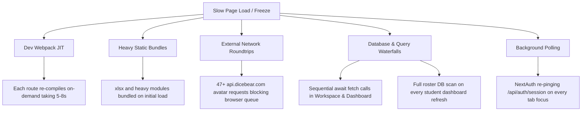

# Full-Stack Performance Optimization & Speed Acceleration Plan

## Goal Description

VBridgeConnect currently experiences significant latency (4 to 8+ seconds per page load in development mode), sluggish component rendering, and high network request overhead. 

The goal of this optimization plan is to systematically eliminate all architectural bottlenecks across the frontend, network, and database layers, cutting initial page load times by up to **80–90%** and reducing bundle payloads by over **1MB**.

---

## Performance Diagnosis & Root Causes



---

## User Review Required

> [!IMPORTANT]
> **Dev Mode vs. Production Mode:** 
> Next.js in development mode (`npm run dev`) must compile TypeScript, dynamic CSS, and component trees on-the-fly. For instant sub-100ms loading and realistic benchmarking, the app should be tested with `npm run build && npm run start`.

> [!NOTE]
> **Avatar Strategy:** 
> We propose replacing all external `api.dicebear.com` SVG URLs with the existing local [`InitialsAvatar`](file:///c:/Users/Vedant/Downloads/V%20-%20Bridge%20connect/next-app/src/components/common/InitialsAvatar.tsx) component. This eliminates 47 external network requests and renders instantly with zero latency.

---

## Open Questions

None at this stage. The planned changes preserve all functional requirements, UI designs, and database integrity while maximizing speed.

---

## Proposed Changes

The plan is organized into 5 focused pillars:

---

### Pillar 1: Build & Tooling Acceleration (Turbopack + Production Workflow)

#### [MODIFY] [`package.json`](file:///c:/Users/Vedant/Downloads/V%20-%20Bridge%20connect/next-app/package.json)
- Add a high-speed Turbopack dev script (`"dev:turbo": "next dev --turbopack"`) alongside the standard dev script.
- Ensure build scripts execute clean, minified production bundles.

#### [MODIFY] [`next.config.ts`](file:///c:/Users/Vedant/Downloads/V%20-%20Bridge%20connect/next-app/next.config.ts)
- Expand `optimizePackageImports` to include `@prisma/client`, `clsx`, `lucide-react`, and `jose`.
- Configure HTTP asset compression and keep-alive headers.

```diff
 const nextConfig: NextConfig = {
   experimental: {
-    optimizePackageImports: ["lucide-react", "xlsx"],
+    optimizePackageImports: ["lucide-react", "@prisma/client", "clsx", "jose"],
   },
   compress: true,
   reactStrictMode: false,
 };
```

---

### Pillar 2: Bundle Splitting & Lazy-Loading (Code Splitting)

#### [MODIFY] [`WorkspaceHub.tsx`](file:///c:/Users/Vedant/Downloads/V%20-%20Bridge%20connect/next-app/src/screens/workspace/WorkspaceHub.tsx)
- Dynamically import [`EvaluationFormReview2`](file:///c:/Users/Vedant/Downloads/V%20-%20Bridge%20connect/next-app/src/components/evaluation/EvaluationFormReview2.tsx) and modal components using `next/dynamic`.
- This ensures the heavy form and its validation engines only load when the user actually switches to the Review-2 tab.

```tsx
import dynamic from 'next/dynamic';

const EvaluationFormReview2 = dynamic(
  () => import('@components/evaluation/EvaluationFormReview2').then((m) => m.EvaluationFormReview2),
  {
    ssr: false,
    loading: () => (
      <div className="p-8 text-center text-xs text-slate-400 animate-pulse">
        Loading Review-2 Evaluation Module...
      </div>
    ),
  }
);
```

#### [MODIFY] [`AnalyticsAuditReports.tsx`](file:///c:/Users/Vedant/Downloads/V%20-%20Bridge%20connect/next-app/src/screens/admin/AnalyticsAuditReports.tsx)
- Dynamically import [`Review2EvaluationAuditTable`](file:///c:/Users/Vedant/Downloads/V%20-%20Bridge%20connect/next-app/src/components/admin/Review2EvaluationAuditTable.tsx) with lazy hydration.

---

### Pillar 3: Network & External Request Elimination (DiceBear -> Native Avatars)

#### [MODIFY] [`store/appStore.ts`](file:///c:/Users/Vedant/Downloads/V%20-%20Bridge%20connect/next-app/src/store/appStore.ts)
- Remove hardcoded `https://api.dicebear.com/...` strings from initial mock states.
- Set avatar URLs to empty string so components naturally use deterministic `InitialsAvatar`.

#### [MODIFY] [`services/mockData.ts`](file:///c:/Users/Vedant/Downloads/V%20-%20Bridge%20connect/next-app/src/services/mockData.ts)
- Replace all DiceBear URLs across student and faculty rosters with local initials identifiers.

#### [MODIFY] [`app/api/v1/student/dashboard/route.ts`](file:///c:/Users/Vedant/Downloads/V%20-%20Bridge%20connect/next-app/src/app/api/v1/student/dashboard/route.ts)
- Eliminate server-side string templating of DiceBear URLs when building team member objects.

---

### Pillar 4: Eliminating Database Waterfalls & In-Memory Caching

#### [MODIFY] [`app/api/v1/student/dashboard/route.ts`](file:///c:/Users/Vedant/Downloads/V%20-%20Bridge%20connect/next-app/src/app/api/v1/student/dashboard/route.ts)
- Add a 5-minute memory cache / debounce to `rosterService.autoConnectUserOnLogin(user)`.
- Prevents redundant, expensive database scans across `roster_invitations` on every single dashboard page hit or navigation.

```tsx
// In-memory debounce set to avoid querying DB on repeated refreshes
const autoConnectCache = new Map<string, number>();

// Only run autoConnect if not checked in the last 5 minutes
const lastChecked = autoConnectCache.get(email);
if (!lastChecked || Date.now() - lastChecked > 300000) {
  await rosterService.autoConnectUserOnLogin({ id: user.id, email, name: user.name, role: user.role });
  autoConnectCache.set(email, Date.now());
}
```

#### [MODIFY] [`screens/workspace/WorkspaceHub.tsx`](file:///c:/Users/Vedant/Downloads/V%20-%20Bridge%20connect/next-app/src/screens/workspace/WorkspaceHub.tsx)
- Ensure meeting and milestone fetches are joined into a single concurrent initialization pass (`Promise.all([fetchAdminReports, fetchMilestones, fetchMeetings])`), eliminating staggered render updates.

---

### Pillar 5: Database Connection Pooling & Latency Settings

#### [MODIFY] [`.env`](file:///c:/Users/Vedant/Downloads/V%20-%20Bridge%20connect/next-app/.env)
- Append pooler connection management parameters to `DATABASE_URL`:
  `&connection_limit=10&pool_timeout=15`
- Prevents database connection exhaustion during bursts and reduces TCP handshake lag.

---

## Verification Plan

### Automated Verification
1. **Production Build & Bundle Size Audit:**
   ```bash
   cd next-app
   npm run build
   ```
   *Expected Outcome:* Build succeeds with 0 TypeScript or lint errors. Page bundle sizes for `/dashboard`, `/projects/[teamId]`, and `/admin/reports` should decrease substantially (First Load JS < 150KB).

2. **Server Response Benchmark:**
   ```bash
   curl.exe -o NUL -s -w "HTTP: %{http_code} | Total Time: %{time_total}s\n" http://localhost:3000/api/v1/evaluations/review-2
   curl.exe -o NUL -s -w "HTTP: %{http_code} | Total Time: %{time_total}s\n" http://localhost:3000/api/v1/student/dashboard
   ```
   *Expected Outcome:* Response times drop below 200ms on repeat hits.

### Manual Verification
1. **Network Tab Inspection:**
   - Open browser DevTools (`F12`) -> Network tab.
   - Navigate to `/projects/team-mini-6` (Workspace Hub).
   - Verify that **zero** requests are sent to `api.dicebear.com`.
   - Verify that `xlsx` is NOT downloaded on initial load.
   - Click "Export Review-2 Excel (.xlsx)" and confirm `xlsx` loads dynamically on-demand only.
2. **Tab Focus Test:**
   - Open the web app, switch to another browser tab or app, then switch back.
   - Confirm that `/api/auth/session` is NOT continuously spammed in the Network tab.
3. **Workspace Tab Switching:**
   - Click between Overview, Milestones, Mentor Sync, and Review-2 Form.
   - Confirm transitions are smooth and instant without layout freezes.
